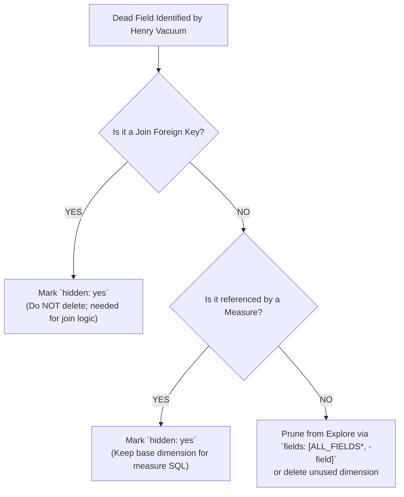

# Henry Command & Dead Code Vacuuming Guide

This reference guide documents standard **Henry CLI** operations, diagnostic parameters, and LookML code-pruning workflows for auditing model bloat, unqueried explores, and dead dimensions across any Looker project.

```
                         HENRY 2-TIER CLEANUP PIPELINE
 ┌───────────────────────────────────────────────────────────────────────────┐
 │ Tier 1: High-Level Exploration Pulse (henry pulse --timeframe=90)         │
 │ • Scans all models to identify 0-query Explores and unreferenced Views    │
 ├───────────────────────────────────────────────────────────────────────────┤
 │ Tier 2: Granular Field-Level Vacuum (henry vacuum --timeframe=90)         │
 │ • Scans individual Explores to pinpoint 0-query Dimensions & Measures     │
 └───────────────────────────────────────────────────────────────────────────┘
```

---

## 1. Core Henry CLI Operations

### A. High-Level Project Pulse (`henry pulse`)
Runs a high-level scan against Looker System Activity to identify explores and views that have had zero user queries over the specified timeframe (default: 90 days):

```bash
# Scan default model / instance-wide for 90 days of inactivity
henry pulse --timeframe=90

# Scan a specific target model
henry pulse --model=<model_name> --timeframe=90

# Output results as formatted JSON
henry pulse --model=<model_name> --timeframe=90 --format=json
```

---

### B. Granular Field-Level Vacuum (`henry vacuum`)
Scans at the explore and field level to identify specific dimensions, measures, and filters that have never been used in queries, saved looks, or dashboards:

```bash
# Vacuum entire model
henry vacuum --model=<model_name> --timeframe=90

# Vacuum a specific explore
henry vacuum --model=<model_name> --explore=<explore_name> --timeframe=90

# Vacuum with minimum query threshold (e.g. fewer than 3 runs in 90 days)
henry vacuum --model=<model_name> --explore=<explore_name> --min-queries=3 --timeframe=90
```

---

## 2. Interpreting Henry Output & Safe LookML Pruning

When Henry identifies dead fields, follow this 4-step safety protocol before removing any code:



### Safe Pruning Rules:
1. **Never delete join keys**: If a foreign key (e.g. `order_items.user_id`) has 0 direct user queries, mark it `hidden: yes`. Do not delete the dimension, as the `join: users` block requires it.
2. **Protect measure dependencies**: If `sale_price` has 0 direct dimension queries but `total_sale_price` (a measure) aggregates it, mark `dimension: sale_price` as `hidden: yes`.
3. **Prune at the Explore Level**: Use LookML `fields: []` to keep the underlying view definition intact while pruning the field picker:
   ```lookml
   explore: orders {
     # Exclude legacy unneeded fields from the explore field picker
     fields: [ALL_FIELDS*, -orders.legacy_tracking_hash, -orders.temp_status]
   }
   ```

---

## 3. Automated Script Execution

For automated CI/CD audits or Python integration, execute Henry via standard subprocess calls:

```python
import subprocess
import json

def audit_dead_fields(model_name: str, timeframe: int = 90) -> dict:
    """Executes Henry vacuum and returns structured JSON output."""
    cmd = ["henry", "vacuum", f"--model={model_name}", f"--timeframe={timeframe}"]
    res = subprocess.run(cmd, capture_output=True, text=True, check=False)
    return {
        "model": model_name,
        "timeframe_days": timeframe,
        "raw_output": res.stdout or res.stderr
    }
```
