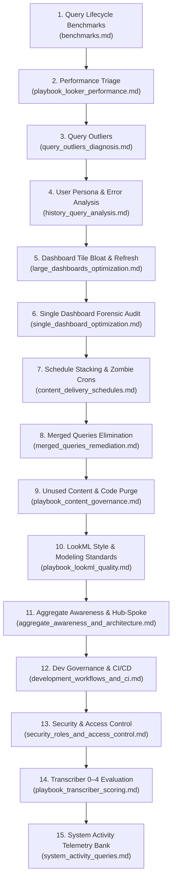

# Master Looker Healthcheck Delivery Playbook

This document defines the authoritative **End-to-End Looker Healthcheck Engagement Delivery Methodology**, stakeholder interview frameworks, thematic review structures, and consultant deliverables structured across the **4 Strategic Pillars**.

```
 ┌─────────────────────────────────────────────────────────────────────────────────────────────┐
 │                               HEALTHCHECK 4-PILLAR JOURNEY                                  │
 ├──────────────────┬──────────────────┬──────────────────────────┬────────────────────────────┤
 │ PILLAR 1:        │ PILLAR 2:        │ PILLAR 3:                │ PILLAR 4:                  │
 │ Discovery &      │ Diagnostics &    │ Thematic Customer        │ Remediation Roadmap &      │
 │ Walkthrough      │ Auditing         │ Review                   │ Handover                   │
 ├──────────────────┼──────────────────┼──────────────────────────┼────────────────────────────┤
 │ • Stakeholder    │ • Live System    │ • Present Thematic Review│ • Delivery of Clean-Up     │
 │   Discovery      │   Activity Audit │   (Themes, not raw tiles)│   Spreadsheet              │
 │ • Instance       │ • Henry Pulse &  │ • High-ROI Findings with │ • Transcriber Action Plan  │
 │   Topology       │   Vacuum Scans   │   Screenshots & Metrics  │ • Style Guide & Testing    │
 │ • Pain Points &  │ • Transcriber    │ • Prioritized Top Actions│   CI/CD Integration        │
 │   Use Patterns   │   0–4 Scoring    │   (<10s queries, caching)│ • Co-Dev / Handover        │
 └──────────────────┴──────────────────┴──────────────────────────┴────────────────────────────┘
```

---

## 1. Pillar 1: Discovery & Stakeholder Interview Protocol

The lead consultant or agent conducts structured discovery across three key stakeholder personas:

### A. BI Leadership & Lead Architect Interview
* **Instance Scale & Growth**: How is your user concurrency, data volume, or developer headcount expected to grow in the next 6–12 months?
* **Cost & Capacity**: What warehouse compute constraints or cost ceilings (e.g. BigQuery slots, Snowflake warehouses) are in place?
* **Release Governance**: What is the current release management process between Development, QA/Staging, and Production instances?
* **Security & Access**: How are users onboarded, and is Group-Based Access Control (GBAC) synchronized with your IdP (Okta, Azure AD, Google Workspace)?

### B. LookML Developer Interview
* **Development Velocity**: What specific friction points exist during local LookML development, validation, or branch merging?
* **Codebase Architecture**: Are models structured modularly, or do monolithic files contain dozens of disparate explores?
* **Derived Tables & ETL**: How are PDTs maintained, and how do datagroup rebuild triggers synchronize with upstream warehouse ETL?
* **Testing & Quality Assurance**: Are LookML data tests written and run automatically prior to merging pull requests?

### C. Business End-User & Consumer Interview
* **Slow Content Inventory**: Which specific dashboards or saved looks take longer than 10 seconds to load?
* **Query Abandonment**: How frequently do users hit "Cancel" or close browser tabs due to unresponsive queries?
* **Field Picker Usability**: Are users confused by duplicated fields, technical foreign keys, or missing business descriptions?
* **Scheduled Deliveries**: Are critical automated reports delivered reliably, or do morning queue backups cause delivery delays?

### D. 30-Day Instance Baseline Telemetry Protocol
Establish high-level operational baseline telemetry across the 30-day lookback window:
* **Query Volume & Execution Mix**: Capture total queries run vs database queries hitting warehouse compute.
* **Macro Latency Metrics**: Capture instance-wide average for `async_processing_average`, `execute_main_query_average`, and `acquire_connection_average`.
* **Telemetry Extraction**: Reference the baseline query catalog in [system_activity_queries.md](system_activity_queries.md).

### E. Required Customer Permissions (Read-Only Least-Privilege)
* **Looker**: `Admin` role, or a custom role on `system__activity` and target models with `see_system_activity`, `develop` (or `see_lookml`), `use_sql_runner`, `see_lookml_dashboards`, `see_user_dashboards`, and `see_schedules`, plus Looker CLI OAuth enabled.
* **BigQuery (Project IAM)**: `roles/bigquery.resourceViewer` (required for `bigquery.jobs.listAll` on `JOBS_BY_PROJECT` and `JOBS_TIMELINE_BY_PROJECT` — `bigquery.dataEditor` alone is insufficient), `roles/bigquery.jobUser` (to run `bq query`), and `roles/bigquery.metadataViewer` (to inspect `TABLE_STORAGE` and `COLUMNS`).

---

## 2. Pillar 2: Master Diagnostic Topic Sequence

To achieve a rigorous, exhaustive instance healthcheck, the consultant or agent executes the following **15 diagnostic topics** organized across strategic domain playbooks and specialized technical recipes:



### Master Diagnostic Topic Execution Matrix

| Topic # | Engineering Domain | Specialized Playbook / Recipe | Review & Diagnosis Focus | Rectification & Remediation Focus | Target Benchmark / SLA |
| :---: | :--- | :--- | :--- | :--- | :---: |
| **1** | **Query Lifecycle Benchmarks** | [benchmarks.md](../references/benchmarks.md) | Audit 12 lifecycle stages against Google Cloud PSO latency thresholds. | Rebalance connections, break up monolithic models, fix Liquid prepare overhead. | `async < 5.0s`, `conn < 0.238s` |
| **2** | **Performance Triage** | [playbook_looker_performance.md](playbook_looker_performance.md) | 4-Step progressive isolation (Dashboard $\rightarrow$ Explore $\rightarrow$ Model $\rightarrow$ Query) & 3-Way forensic triage. | Tune connection pool, remove table calculations, align datagroup caching. | `Overhead < 20%`, `Cache > 50%` |
| **3** | **Query Outliers** | [query_outliers_diagnosis.md](../references/query_outliers_diagnosis.md) | Profile slowest queries (>8s) and isolated runtime spikes. | Implement partition filters, cluster keys, and PDT pre-aggregation. | 0 queries $> 30\text{s}$ in prod |
| **4** | **User Persona & Error Analysis** | [history_query_analysis.md](../references/history_query_analysis.md) | Query volume by persona (Viewer vs Explorer vs Dev); calculate Error % and Killed %. | Remediate failing looks, address user query abandonment causes. | $\text{Killed Rate} < 5\%$ |
| **5** | **Dashboard Density & Auto-Refresh** | [large_dashboards_optimization.md](../references/large_dashboards_optimization.md) | Identify dashboards with $>25$ query tiles or auto-refresh $< 30\text{m}$. | Deconstruct into tabbed layouts, link via HTML drill-down links, clamp refresh to ETL. | $\le 25\text{ tiles}$, $\text{Refresh} \ge \text{ETL}$ |
| **6** | **Single Dashboard Audit** | [single_dashboard_optimization.md](../references/single_dashboard_optimization.md) | 10-Point forensic checklist on specific mission-critical dashboards. | Set row limits to 1 on single-value tiles, enforce global dashboard filters. | 10/10 Forensic Compliance |
| **7** | **Schedules & Zombie Crons** | [content_delivery_schedules.md](../references/content_delivery_schedules.md) | Scan for top-of-hour (`:00`) schedule stacking, un-paged "Send All", and disabled user crons. | Stagger schedules off-hour (`:07`, `:22`, `:37`), disable "Send All", delete zombie crons. | 0 schedules on `:00` peak |
| **8** | **Merged Queries** | [merged_queries_remediation.md](../references/merged_queries_remediation.md) | Locate in-memory merged query tiles causing browser crashes and JVM RAM bloat. | Refactor merged queries into native LookML `join:` relationships in Explore files. | 0 merged tiles in production |
| **9** | **Unused Content & Code Bloat** | [playbook_content_governance.md](playbook_content_governance.md) | Scan for 90-day 0-query dashboards, looks, explores, and dead fields via Henry CLI. | Execute 3-stage deprecation funnel: Soft delete $\rightarrow$ Archive $\rightarrow$ Hard delete. | 0 unused explores exposed |
| **10** | **LookML Style & Standards** | [playbook_lookml_quality.md](playbook_lookml_quality.md) | Audit snake_case compliance, mandatory measure prefixes (`total_`, `count_`), `primary_key: yes`. | Enforce DRY modeling, standard drill fields, hide foreign keys (`hidden: yes`). | 100% snake_case & primary keys |
| **11** | **Aggregate Awareness & Architecture** | [aggregate_awareness_and_architecture.md](../references/aggregate_awareness_and_architecture.md) | Profile high-traffic explores suitable for compact rollups; audit project modularity. | Add `aggregate_table:` definitions; restructure monolithic repos to Hub & Spoke. | Sub-second dashboard queries |
| **12** | **Development Workflows & CI/CD** | [development_workflows_and_ci.md](../references/development_workflows_and_ci.md) | Evaluate Git branching, pull request reviews, automated LookML data tests, and CI/CD. | Implement 3-Tier maturity framework, write `tests/*.test.lkml`, configure GitHub Actions. | Automated CI pre-merge gate |
| **13** | **Security & Access Control** | [security_roles_and_access_control.md](../references/security_roles_and_access_control.md) | Audit direct user role assignments, admin sprawl, orphan roles, and user attribute caching. | Enforce Group-Based Access Control (GBAC), implement `access_grant:` row-level security. | 0 direct-user role bindings |
| **14** | **Transcriber Scoring** | [playbook_transcriber_scoring.md](playbook_transcriber_scoring.md) | Grade instance across 4 Dimensions (LookML, UX, Architecture, Governance) on 0–4 scale. | Produce Transcriber Action Plan & weighted scoring breakdown. | Overall Score $\ge 2.5 / 4.0$ |
| **15** | **System Activity Query Bank** | [system_activity_queries.md](../references/system_activity_queries.md) | Centralized query dictionary supporting all automated and ad-hoc telemetry extraction. | Run JSON query definitions against Looker `system__activity` models. | Instant diagnostic execution |

---

## 3. Pillar 3: Thematic Customer Review

Consultant findings must **never be presented as raw, disorganized tile dumps**. They must be synthesized into **4 Core Consulting Themes**:

### Theme 1: Computation & Warehouse Efficiency
* **Cache Alignment**: Are user queries taking advantage of Looker memory cache ($>50\%$), or are uncoordinated `persist_for` windows hammering the database?
* **Aggregate Rollups**: Have repetitive dashboard summary queries been accelerated with `aggregate_table:` definitions?
* **Partition & Cluster Pruning**: Are LookML views enforcing `conditionally_filter` or `require_partition_filter: yes` on large warehouse tables?

### Theme 2: Concurrency & Instance Load
* **Connection Pool Sizing**: Is `acquire_connection` causing query queues during peak morning hours?
* **Schedule Distribution**: Are automated reports stacked at `:00`, causing scheduler starvation?
* **Dashboard Query Multipliers**: Are dashboards with $>25$ tiles or in-memory merged queries overwhelming the Looker JVM?

### Theme 3: LookML Model Quality & Hygiene
* **Data Integrity**: Are all joined views declaring `primary_key: yes` to prevent fanout calculation errors?
* **Explore Curation**: Have unused fields and raw technical foreign keys been hidden (`hidden: yes`) to prevent user confusion?
* **Dead Code Pruning**: Has 90-day inactive LookML been decommissioned to maintain a clean, maintainable repository?

### Theme 4: Governance & Developer Velocity
* **Quality Assurance Gateways**: Are pull requests peer-reviewed and tested with automated LookML data tests before production deployment?
* **Access Control Security**: Are permissions managed exclusively through IdP-synchronized mirror groups (GBAC)?

---

## 4. Pillar 4: Remediation Roadmap & Deliverables

At the conclusion of the engagement, the consultant or agent generates and delivers the standard **Healthcheck Handover Package**:

1. **Executive 30-Check Diagnostic Scorecard & Synthesis** (Relayed dynamically to the user and persisted to Firestore):
   * Instance-wide or model-scoped overall health score (0–100%).
   * Executive scorecard summarizing status (🟢 PASSED, 🟡 WARNING, 🔴 CRITICAL) for all 30 checks.
   * Google Cloud PSO Query Lifecycle Latency Benchmark analysis.
   * Prioritized list of high-ROI remediation items mapped directly to specialized skill playbooks.
2. **Transcriber Action Plan & Spreadsheet**:
   * Detailed line-item breakdown of 0–4 scores across LookML Quality, End-User Experience, Architecture, and Data Culture.
   * Clear remediation owners, estimated effort, and target completion dates.
3. **Automated CI/CD Pipeline & Data Test Config**:
   * Pre-configured `.github/workflows/looker_ci.yml` or GitLab CI pipeline running `looker-cli project validate` and automated `tests/*.test.lkml`.
4. **Co-Development & Enablement Session**:
   * Hands-on 2-hour refactoring workshop with customer LookML developers demonstrating datagroup caching, aggregate table implementation, and primary key enforcement.
