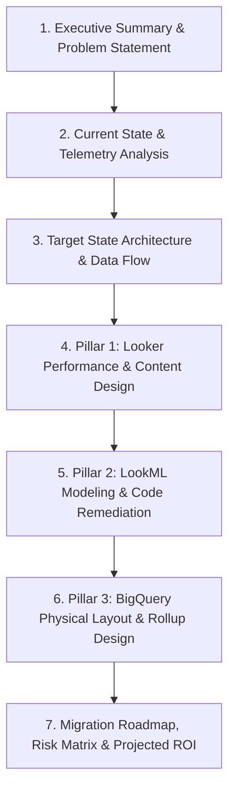

# Enterprise Technical Design Document (TDD) Authoring Playbook

This playbook establishes the standard for generating an **Authoritative, Publication-Grade Technical Design Document (TDD)** for Looker & BigQuery modernization engagements.

A proper TDD is **NOT** a summary pass/fail table. It is an end-to-end engineering specification that diagnoses root causes, praises good architectural patterns, prescribes exact LookML/SQL code solutions, diagrams target data flows, and maps out a low-risk migration roadmap.

---

## 🏛️ Mandatory 7-Section Technical Design Document Architecture



---

### Section 1: Executive Summary & Problem Statement
* **Business & Architectural Context**: Target Looker model, project scope, database connection, and dataset environment.
* **Modernization Objectives**: Concrete target KPIs (e.g. reduce average explore query latency from 18s to <3s, eliminate 200+ peak slot spikes, eliminate fan-out double counts).
* **Overall Health Score & Pillar Ratings**: Numerical baseline scores derived from the audit.

---

### Section 2: Current State Architecture & Telemetry Analysis
* **2.1 What Is Working Well (Architectural Strengths)**:
  - Explicitly document features, models, or configurations that adhere to best practices (e.g. valid LookML syntax, connection pooling, clean folder structure, well-defined user roles).
* **2.2 Latency Phase & Lifecycle Breakdown**:
  - Detailed analysis of the query lifecycle: Looker JVM overhead % vs BigQuery `execute_main_query` vs connection queue wait (`acquire_connection`).
* **2.3 Compute & Slot Bottlenecks**:
  - Exact `INFORMATION_SCHEMA` data: slot saturation curves (>200 slots), bytes billed per hour, and warehouse contention.
* **2.4 Slow Query Outlier Deep-Dive**:
  - Forensic breakdown of specific slow queries (>10s–25s) with exact Job IDs, runtime durations, and anti-pattern classifications.

---

### Section 3: Target State Architecture & Data Flow
* **Comprehensive Mermaid Architecture Diagram**:
  - Visualizing the end-to-end path from Client / User Dashboards -> Looker Query Engine & Datagroups -> Aggregate Awareness Layer -> BigQuery Partitioned/Clustered Physical Tables & BI Engine.
* **Architectural Principles**:
  - SQL pushdown over client-side computation.
  - Symmetric aggregate elimination through mandatory primary keys.
  - Deterministic caching aligned with upstream ETL completion.
  - Hard partition pruning on high-volume fact tables.

---

### Section 4: Pillar 1 Technical Design (Looker Performance & Content Governance)
* **4.1 Dashboard Density & Tile Decoupling**:
  - Architectural plan to decompose monolithic dashboards (>25 tiles, e.g. 35-tile monster) into modular tabbed navigation dashboards or sub-topic views (<= 25 tiles).
* **4.2 Caching Strategy & Datagroup Redesign**:
  - Replace non-deterministic UUID / timestamp triggers (`GENERATE_UUID()`) with ETL watermark triggers:
    ```lookml
    datagroup: etl_watermark_datagroup {
      sql_trigger: SELECT MAX(created_at) FROM `<project_id>.<dataset_id>.<fact_table>` ;;
      max_cache_age: "4 hours"
    }
    ```
* **4.3 Explore Filter Enforcement**:
  - Mandate `always_filter` or `conditionally_filter` on high-volume explores (`events`, `order_items`) to prevent unbounded multi-GB table scans.
* **4.4 Schedule Staggering Architecture**:
  - Strategy to distribute scheduled deliveries across off-peak minutes (e.g. `:07`, `:22`, `:37`, `:52`) to prevent `:00` connection queue pileups.

---

### Section 5: Pillar 2 Technical Design (LookML Modeling & Code Remediation)
* **5.1 Primary Key Integrity Strategy**:
  - Declare `primary_key: yes` on all views (e.g. `orders`, `users`, `order_items`) to eliminate heavy `SUM(DISTINCT ...)` symmetric aggregate hashing overhead.
* **5.2 Join Relationship & SQL Condition Refactoring**:
  - **Eliminate Cartesian Cross Joins**: Replace `type: cross` with dimensional joins or pre-aggregated derived tables.
  - **Refactor Non-Equi Self-Joins**: Replace O(N^2) inequality joins with window functions or partitioned date arrays.
  - **Remove Functions/Regex from `sql_on:`**: Replace `LOWER(TRIM(...))` and `REGEXP_CONTAINS(...)` with clean indexed join keys.
* **5.3 Before & After LookML Code Diffs**:
  - Provide copy-paste LookML code blocks showing the exact refactored explores, views, and joins.

---

### Section 6: Pillar 3 Technical Design (BigQuery Engine & Physical Storage Layout)
* **6.1 Physical Table Partitioning & Clustering DDL**:
  - Exact BigQuery SQL DDL to recreate unpartitioned tables with date partitioning and high-cardinality clustering:
    ```sql
    CREATE OR REPLACE TABLE `<project_id>.<dataset_id>.<table_name>_partitioned`
    PARTITION BY DATE(created_at)
    CLUSTER BY user_id, status AS
    SELECT * FROM `<project_id>.<dataset_id>.<table_name>`;
    ```
* **6.2 Aggregate Awareness Rollup Design**:
  - Provide complete LookML `aggregate_table` specifications for high-frequency dashboard queries:
    ```lookml
    aggregate_table: rollup__daily_sales_by_country {
      query: {
        dimensions: [created_date, users.country]
        measures: [total_sale_price, count]
      }
      materialization: {
        datagroup_trigger: thelook_etl_datagroup
      }
    }
    ```
* **6.3 Warehouse Slot & BI Engine Sizing**:
  - Sizing recommendations for BI Engine memory allocation and query acceleration.

---

### Section 7: Phased Migration Roadmap, Risk Matrix & Projected ROI
* **7.1 3-Phase Rollout Plan**:
  - **Phase 1: Zero-Risk Hotfixes (Days 1–3)**: Datagroup trigger fixes, primary key additions, explore filter enforcement.
  - **Phase 2: LookML & Dashboard Restructuring (Weeks 1–2)**: Dashboard tile decoupling, join condition refactoring, table calculation cleanup.
  - **Phase 3: Physical Warehouse Modernization (Weeks 3–4)**: BigQuery table partitioning/clustering, Aggregate Awareness deployment.
* **7.2 Risk Assessment & Rollback Procedures**:
  - Step-by-step Git branch revert commands and BigQuery table restore snapshots.
* **7.3 Quantified ROI & Business Value Projection**:
  - Comparative table projecting before vs. after metrics:
    | Metric | Current Baseline | Target State | Expected Improvement |
    | :--- | :---: | :---: | :---: |
    | **Average Explore Latency** | 15–26s | <2.5s | **85–90% Reduction** |
    | **Peak Slot Utilization** | 215 Slots | <45 Slots | **79% Slot Capacity Freed** |
    | **Daily Warehouse Scan Volume** | Unbounded (GBs) | Partition-Pruned (MBs) | **70–80% Cost Reduction** |
    | **Dashboard Tile Render Time** | Saturated (35 Tiles) | Fast Modular (<=25 Tiles) | **3x Faster User Experience** |
