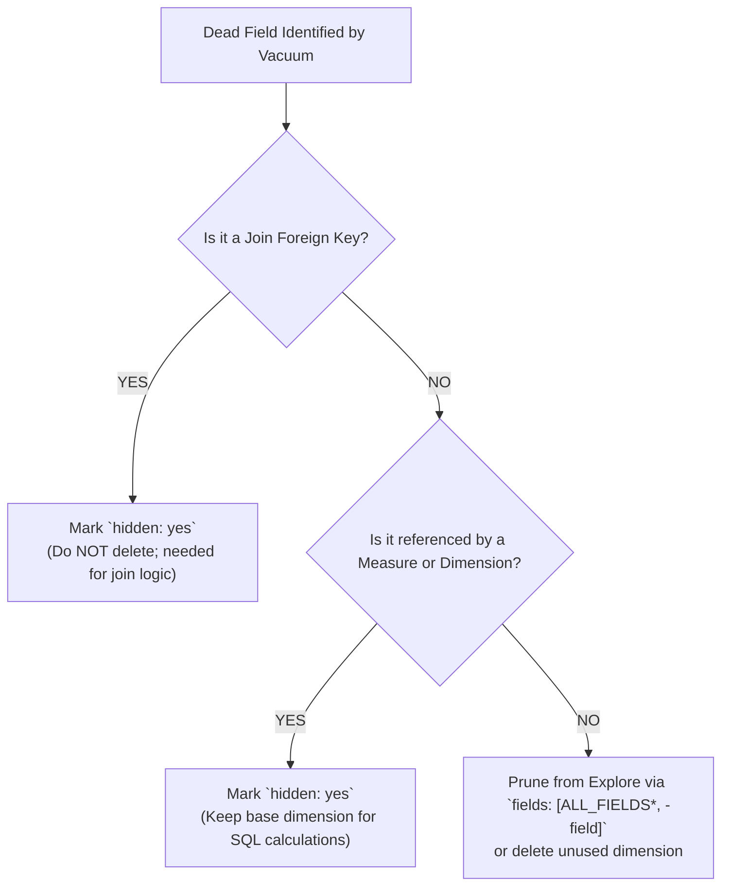

# Looker CLI Health & Vacuum Guide

This reference guide documents standard **Looker CLI (`looker-cli`)** health check, pulse inspection, and asset vacuuming workflows for auditing instance vitals, model bloat, unqueried explores, and unused dimensions/measures.

```
                   LOOKER-CLI HEALTH & VACUUM PIPELINE
 ┌───────────────────────────────────────────────────────────────────────────┐
 │ Tier 1: Rapid Instance Pulse (looker-cli health pulse)                    │
 │ • Rapid check of dashboard performance, errors, explores, and connections │
 ├───────────────────────────────────────────────────────────────────────────┤
 │ Tier 2: Model-Level Vacuum (looker-cli health vacuum models)              │
 │ • Scans models to identify 0-query Explores over a timeframe (e.g. 90d)   │
 ├───────────────────────────────────────────────────────────────────────────┤
 │ Tier 3: Granular Field-Level Vacuum (looker-cli health vacuum explores)   │
 │ • Scans individual Explores to pinpoint 0-query Joins, Fields & Measures  │
 ├───────────────────────────────────────────────────────────────────────────┤
 │ Tier 4: Health Analyze (looker-cli health analyze projects|models)        │
 │ • Deep health telemetry across projects, models, and explores             │
 └───────────────────────────────────────────────────────────────────────────┘
```

---

## 1. Rapid Health Pulse (`looker-cli health pulse`)

The `health pulse` suite runs immediate diagnostic checks against instance telemetry:

```bash
# Run all health pulse checks at once
looker-cli health pulse

# Dashboard query performance (identifies queries > 30s in last 7 days)
looker-cli health pulse dashboard-performance

# Dashboard errors (identifies failing queries in last 7 days)
looker-cli health pulse dashboard-errors

# Explore performance (slowest explores in past 7 days)
looker-cli health pulse explore-performance

# Schedule failures (quick check for broken schedules)
looker-cli health pulse schedule-failures

# Database connection status, query volume, and latency
looker-cli health pulse db-connections

# Legacy features check
looker-cli health pulse legacy-features
```

### Useful Pulse Flags:
* `--csv`: Output results in CSV format for automated parsing or spreadsheets.
* `--plain`: Output without terminal color formatting (ideal for piping to scripts).

---

## 2. Unused Asset Vacuuming (`looker-cli health vacuum`)

`looker-cli health vacuum` identifies unused explores, joins, and fields that can be safely pruned to eliminate model bloat and improve context clarity.

### A. Model-Level Explore Vacuum (`vacuum models`)
Scans models to find explores that have received zero user queries over the specified timeframe:

```bash
# Scan instance-wide across all models (default: 90 days, min 1 query)
looker-cli health vacuum models

# Scan a specific target model
looker-cli health vacuum models --model=<model_name>

# Filter by project
looker-cli health vacuum models --project=<project_name>

# Custom timeframe and minimum query threshold
looker-cli health vacuum models --model=<model_name> --timeframe=90 --min-queries=3

# Output as CSV
looker-cli health vacuum models --model=<model_name> --csv
```

---

### B. Explore-Level Join & Field Vacuum (`vacuum explores`)
Scans inside explores to pinpoint specific joins, dimensions, and measures that have never been used in queries, saved looks, or dashboards:

```bash
# Vacuum all explores in a model
looker-cli health vacuum explores --model=<model_name>

# Vacuum a specific explore
looker-cli health vacuum explores --model=<model_name> --explore=<explore_name>

# Vacuum with custom timeframe and query threshold
looker-cli health vacuum explores --model=<model_name> --explore=<explore_name> --timeframe=90 --min-queries=3

# Output as CSV
looker-cli health vacuum explores --model=<model_name> --explore=<explore_name> --csv
```

---

## 3. Health Analysis (`looker-cli health analyze`)

Performs deeper health analysis on Looker assets to quantify usage patterns:

```bash
# Analyze all projects
looker-cli health analyze projects

# Analyze models across a 90-day window
looker-cli health analyze models --timeframe=90

# Analyze explores
looker-cli health analyze explores --timeframe=90
```

---

## 4. Safe LookML Pruning Protocol

When `looker-cli health vacuum` identifies dead fields or unused explores, follow this 4-step safety protocol before deleting any code:



### Safe Pruning Rules:
1. **Never delete join keys**: If a foreign key (e.g. `order_items.user_id`) has 0 direct user queries, mark it `hidden: yes`. Do not delete the dimension, as `join: users` relies on it in `sql_on`.
2. **Protect measure dependencies**: If `sale_price` has 0 direct dimension queries but `total_sale_price` aggregates `${TABLE}.sale_price`, keep `dimension: sale_price` and mark it `hidden: yes`.
3. **Prune at the Explore Level**: Use LookML `fields: []` to keep the underlying view definition intact while removing clutter from the business user field picker:
   ```lookml
   explore: orders {
     # Exclude legacy unneeded fields from the explore field picker
     fields: [ALL_FIELDS*, -orders.legacy_tracking_hash, -orders.temp_status]
   }
   ```
4. **Pre-Merge Content Validation**: Always run Content Validator via `looker-cli api content content_validation` before committing field deletions to ensure no saved looks or dashboard tiles break.
